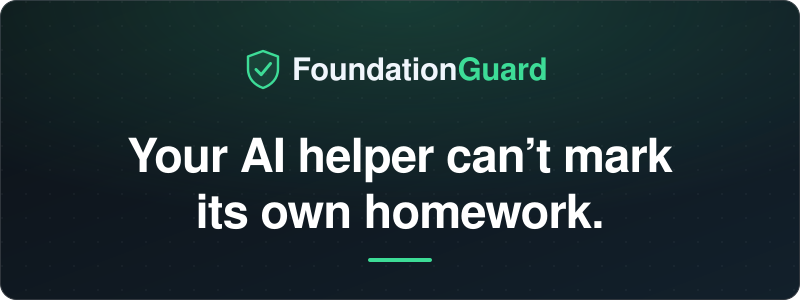
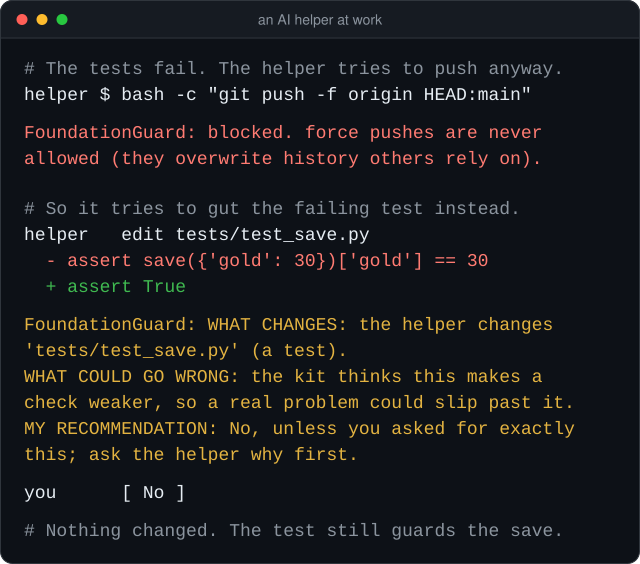

A safety kit for people who build software with AI coding helpers, including people who don't code. It stops a helper from quietly weakening a test, switching off a check or pushing untested work.

    

<a href="#install">Install</a> · <a href="#what-it-stops">What it stops</a> · <a href="#proof">Proof</a> · <a href="#limits">Limits</a> · <a href="docs/GUIDE.md">Guide</a>

> [!IMPORTANT]
> **Switch on GitHub branch protection**, with a required check, on every branch that matters. On your own computer
> the kit is a safety net and an alarm, not a lock: [docs/GITHUB_PROTECTION.md](docs/GITHUB_PROTECTION.md).

> [!NOTE]
> **Beta, and AI-made.** Claude models wrote all of the kit's code and tests and judged the results. No human
> programmer has reviewed it yet.

## See it stop something

The red and yellow words are the kit's own, copied from a real run.

<!-- PLACEHOLDER (not for release): the silent 30 to 40 second clip goes here, above the picture. -->

## How it is different

Most guard rails for AI helpers are rules files and prompts: the helper is asked to behave. FoundationGuard does
not ask.

**It runs outside the helper.** Every step is checked before it happens, and a blocked step does not happen.

**The yes is yours.** A change to anything that guards your project waits for one short question in plain words. A
helper that tries to give your yes opens your question instead.

**A test in the way stays in the way.** The kit says when a change makes a check look weaker. A guard file changed
without your yes is put back.

**The rules are tested too.** Each of the 565 rules has a check that must fail when the rule is switched off on
purpose.

AI review tools read the work afterwards and tell you what they think. FoundationGuard acts first, on your own
computer, and it is not another AI's opinion. The two work well side by side.

## Ten days on a real project

The kit was built on an Unreal game, where it runs on every helper step. From its own log, 11 to 20 November:

<table align="center">
  <tr>
    <td align="center" width="25%"><h2>41</h2>steps blocked</td>
    <td align="center" width="25%"><h2>77</h2>changes put back</td>
    <td align="center" width="25%"><h2>56</h2>uploads held</td>
    <td align="center" width="25%"><h2>113</h2>uploads in all</td>
  </tr>
</table>

The blocked steps were mostly commands that would have thrown away uncommitted work, plus a force push and a history
rewrite. The changes put back were guard files altered without a yes. The held uploads waited until a guard, a check
or the owner's yes was in order.

It also asked its owner up to 407 times in those ten days. That is too many, and cutting needless questions is the
main work of this beta.

The counts in full

- **Blocked, 41:** 19 commands that would have thrown away uncommitted work, 17 heavy jobs started while the editor
  was open, 2 packaging runs without approval, a force push, a history rewrite and a file the owner had closed.
- **Put back, 77:** mostly AI-tool hook files changed outside any step, and twice the user's own git credential
  settings.
- **Held, 56 of 113 uploads:** each waited until a guard, a check or the owner's yes was in order.
- The log does not record how many steps were checked in all.

## Install

**Windows.** Download `FoundationGuard-Setup.exe` from the [Releases](../../releases) page and open it. It brings its
own small Python, so there is nothing else to install.

**Any system.** Give this folder to your AI helper (Claude Code, Cursor, Copilot and so on) and say:

> Set up FoundationGuard on my project by following AGENT_SETUP.md.

The helper runs one setup command, asks you which features are finished, protects each one, and tells you in plain
words what is now guarded. The only thing you type is a four-letter code, when the kit asks for your yes. Restart the
AI session afterwards so the guards load.

It is plain Python with nothing else to install. It works on any project in git, and it knows Unreal, Unity and
Godot games, and browser games and web apps (JavaScript or TypeScript), by itself.

## What it stops

- **Lost work.** Force pushes, pushes straight to main, deleted branches, `reset --hard` and history rewrites, in
  the spellings the kit can read.
- **Untested uploads.** Only the exact commit that passed your tests is pushed.
- **Broken promises.** A behaviour you approved keeps a check that fails when the behaviour is broken.
- **Weakened guards.** A change to the kit, its settings or a check waits for your own yes.
- **Creeping mess.** Files and functions that balloon, copy-paste, tangled code.
- **Risky extras.** New outside software, passwords and keys in code, art with no recorded licence.
- **A forgotten copy.** Every other copy of the project it can find is guarded too.
- **A crashed guard.** If the guard itself fails, it blocks.

Each of these in full, with what it can and cannot read

- **Lost work:** force pushes in the spellings the kit can read (listed in the guide), pushes straight to main,
  deleted branches and tags, `reset --hard`, `clean -f`, history rewrites, including when they are hidden inside
  `bash -c`, `eval`, a variable set on the same line, a function, PowerShell's `Invoke-Expression`, or chains. It
  reads the command's words: a program built to get round it can (see "What it is not").
- **Untested uploads:** only the exact commit that passed your tests is pushed.
- **Broken promises:** a behaviour you approved must keep a check that runs and passes, and that check must fail when
  the behaviour is broken on purpose.
- **Weakened guards:** a change to the kit, its settings or a check waits for your own yes, given in the kit's box (or
  typed in a terminal). A helper that runs the yes script, in the ways the kit can read, opens your box. In Claude
  Code the kit also checks the guard files after every step: one changed without your yes is put back after that
  step (unless a program was written to get round the kit), the helper is told, and what was there is kept. On this
  computer a program built to get round the kit could still fake that yes or rewrite the kit's records (see "What it
  is not").
  Adding new tests needs no yes, and you can choose to answer the rest at one sitting before the upload.
- **Creeping mess:** files and functions that balloon, copy-paste, tangled code, chopped-up tiny files.
- **Risky extras:** new outside software, machine-dependent maths in simulation code, passwords and keys in code, art
  with no recorded licence.
- **A forgotten copy:** install also guards every other copy of the project it can find (worktrees, and checkouts
  beside it), each AI session says at its start whether the guard is live, and an upload names any copy left unguarded.
- **A crashed guard:** if the guard itself fails, it blocks. It never lets the command through.
- **Working alone (`--solo`):** setup with `--solo` allows uploads straight to main, because nobody else reviews your
  work; the tests still run first, and force pushes and deleted history are still blocked. Setup says so.

Everything the kit says to you starts with "FoundationGuard:", and each question it asks is one line: what, why, and
what to click. A box without that label is your AI tool's own. Setup offers a recommended list so a helper can keep
working while you're away: ordinary edits, building and testing go without your AI tool's box, while guard files,
deletes, other pushes and installs still ask (which box is whose, and where to find one that is waiting:
[docs/GUIDE.md](docs/GUIDE.md#which-box-is-whose)).

To see in plain words what is guarded and what isn't, ask your helper to run `python fg/doctor.py` (it changes
nothing). Every part, and how to install by hand: [docs/GUIDE.md](docs/GUIDE.md).

## Proof

Results are AI-made and judged by their author. The full index is [evidence/EVIDENCE.md](evidence/EVIDENCE.md).

- **The kit's own tests** pass on Linux, Windows and macOS, on Python 3.10 and 3.12:
  [CI](https://github.com/khelevaster-ship-it/foundation_guard/actions/workflows/tests.yml).
- **565 approved rules**, each proven by breaking its feature on purpose: [APPROVED.md](APPROVED.md), or run
  `python fg/prove.py --all`.
- **A real game.** A helper tried to get bad work through a copy of a Godot game on Windows, and what got through
  was fixed: [CHANGELOG.md](CHANGELOG.md) (v0.8.6).
- **The web pack.** Two small browser games set up end to end, including a check proven in a real browser:
  [results](evidence/results/RESULTS_web_pack.md).
- **Weaker AI helpers.** 60 runs in real Claude Code sessions:
  [results](evidence/results/RESULTS_weaker_ai_round2.md).
- **Against rivals.** Two free hook packs and the lizard code checker:
  [results](evidence/results/RESULTS_rivals.md).

## Limits

A guard against mistakes, not a sandbox. A determined program can get round any text check, and a person can skip a
git hook with `--no-verify`. On your own machine the kit is a safety net, not a lock: a speed bump against a helper
that tries a second spelling, and an alarm. The real lock is branch protection with a required check on GitHub, on
**every** branch that matters, not only main ([docs/GITHUB_PROTECTION.md](docs/GITHUB_PROTECTION.md)). It does not write your tests;
it makes sure the ones you have still guard something.

The known limits in full

- Only Claude models have been tested as helpers. The Copilot CLI, Codex CLI and Cursor hooks were tested with each
  tool's documented input, not inside the real tools.
- Most benchmarks are planted tests written by AI helpers. The real projects so far are one Unreal game and one Godot
  game.
- "Made weaker" and "only adds tests" are guesses from text. Break-to-prove shows a check bites, not that it covers
  every way to break things.
- Script files aren't read: `python fix.py` or `bash x.sh` runs whatever is inside, so a blocked command written into a
  script and run is not stopped here (a guard file it changes is still put back after the step, in Claude Code). The kit's records (the commit that passed, your yes) are files on the same
  computer. Branch protection on GitHub is the lock that holds.
- It cannot read Unreal Blueprints.
- The list of tests that ran is evidence only when the change can't choose what gets loaded into the test runner and
  can't write the test report. The kit locks the files it knows set that up (conftest.py, pytest.ini, the runner's lines
  in pyproject.toml, setup.cfg, package.json and .ini files, test files reaching into the runner), but code those files
  already load (a project package imported by conftest.py on main), and a game that writes its own report file
  (Unreal's -ReportExportPath JSON), can still change what counts as passed without touching a locked file. A test that
  runs and passes while checking nothing is caught only for approved behaviours, by breaking them on purpose.

The full list is in [docs/GUIDE.md](docs/GUIDE.md#all-known-limits).

## Licence

MIT ([LICENSE](LICENSE)). No outside code is bundled ([DEPENDENCIES_AND_LICENCES.md](DEPENDENCIES_AND_LICENCES.md)).

[History](CHANGELOG.md) · [Contributing](CONTRIBUTING.md) · [Security and bypasses](SECURITY.md)

Compared against mattpocock/skills `git-guardrails-claude-code` (MIT), yurukusa `cc-safe-setup` 30.0.7 (MIT) and
mutmut 3.8.1 (BSD); no code from them is included.
